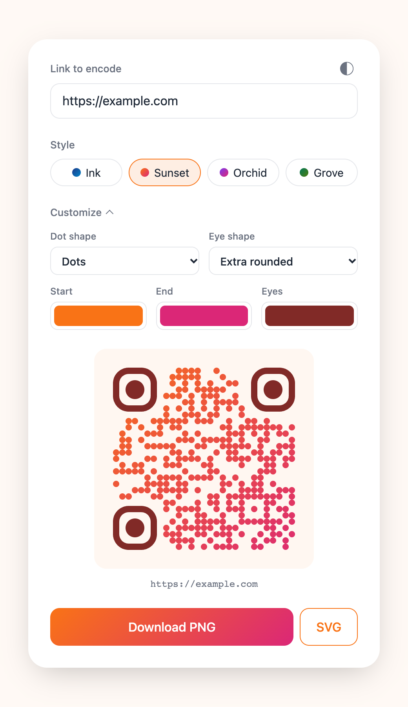
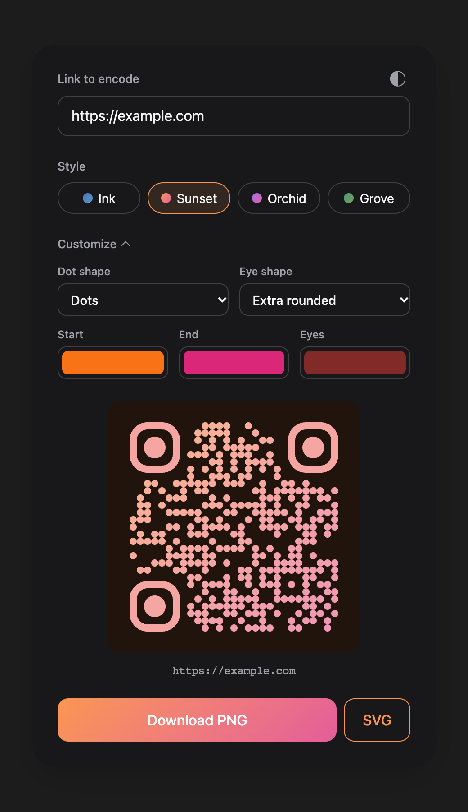

# QR Studio

**Beautiful QR codes in a few seconds.**

Paste a link, pick a style, and download a code with soft shapes and smooth gradients that still scans. It runs entirely in your browser, so there's nothing to sign up for and nothing is uploaded.

<p align="center">
  
  &nbsp;
  
</p>

## What you get

- **Four ready-made styles.** Ink, Sunset, Orchid and Grove. Choose one and you're done.
- **Your own look.** Change the dot shape, the corner shape, both ends of the gradient and the corner colour. The rest of the design adjusts to match.
- **Light and dark.** It follows your system and has a one-click switch. The code itself switches too.
- **Crisp downloads.** PNG at 1120 × 1120 px, or SVG that stays sharp at any size, from a business card to a banner.
- **Private by design.** Your link never leaves your device.

## Get started

You'll need [Node.js](https://nodejs.org) (or [Bun](https://bun.sh)).

```sh
npm install
npm run dev
```

Open the address it prints, and you're in.

1. Paste your link.
2. Pick a style.
3. Open **Customize** to make it yours.
4. Download a **PNG**, or an **SVG** for print.

## Print with confidence

Decorative codes trade a little robustness for beauty, so scan yours with a phone before you print it.

- Keep your gradient dark enough to stand out from the background. Very pale colours can fail to scan.
- Dark mode draws light dots on a dark tile. Most phone cameras read these, but some scanners don't, so export in light mode for anything that has to work everywhere.

## Make a style your own

Every style is a single line in `src/styles.ts`: a name, two shapes and two colours.

```ts
{ name: "Sunset", dots: "dots", corners: "extra-rounded", colors: ["#f97316", "#db2777"] }
```

Add a line, change the colours, or remove a style, and it shows up in the picker. Everything else is worked out from those two colours: the pale tile, the deeper corner colour and the dark-mode look.

- **Dots:** `square`, `rounded`, `extra-rounded`, `dots`, `classy`, `classy-rounded`
- **Corners:** `square`, `extra-rounded`, `dot`

## Credits

Made possible by [qr-code-styling](https://github.com/kozakdenys/qr-code-styling), which draws the codes, and [Vite](https://vite.dev) and [TypeScript](https://www.typescriptlang.org), which power the page.

## License

[MIT](LICENSE)
